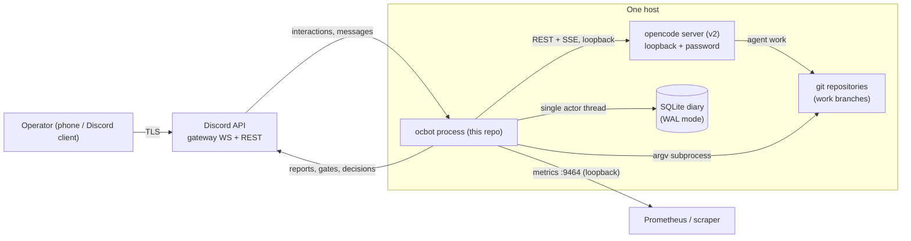
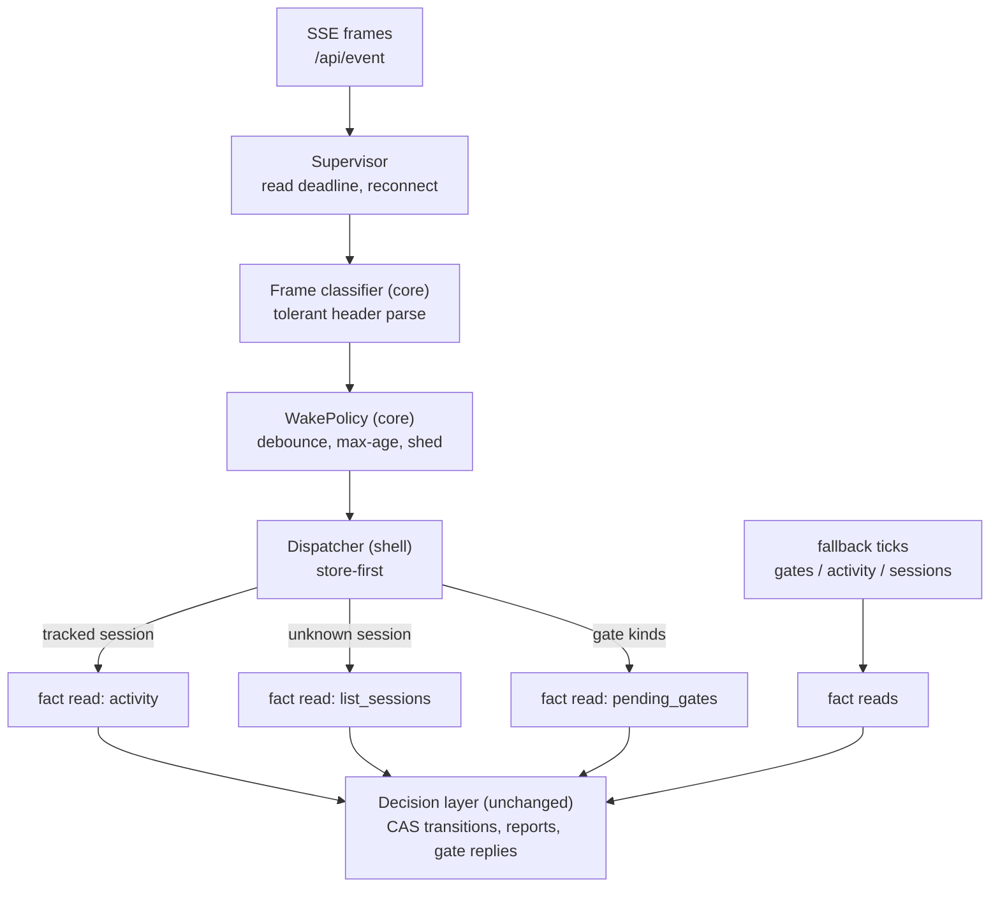
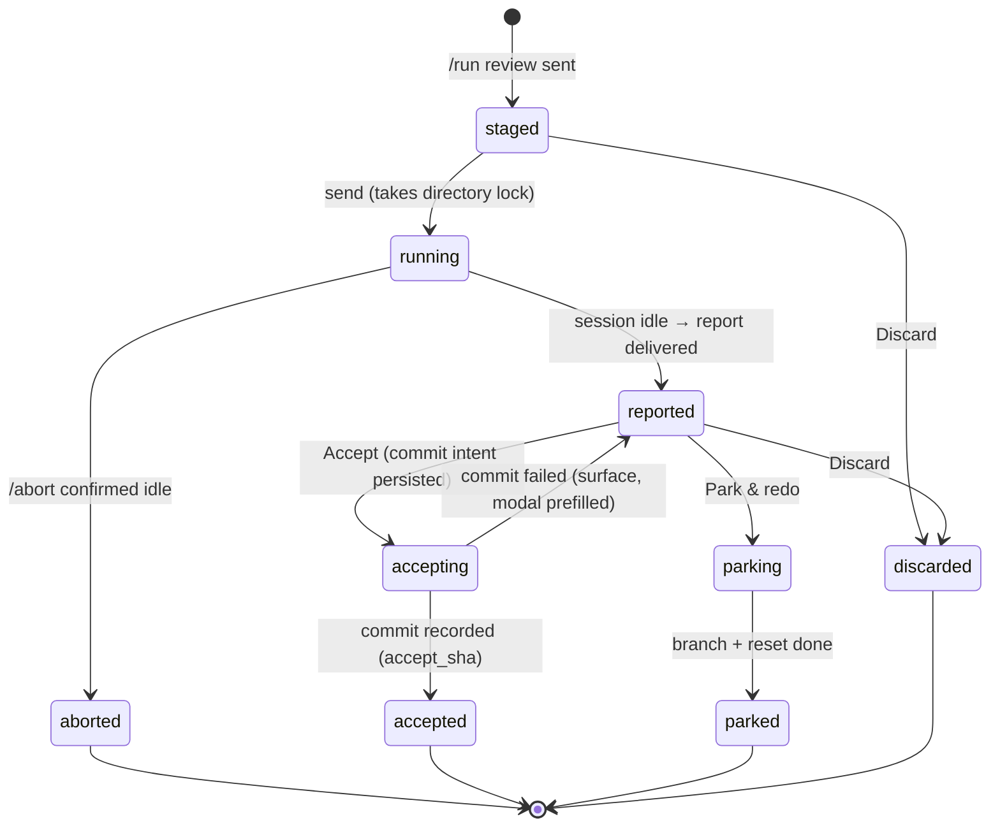
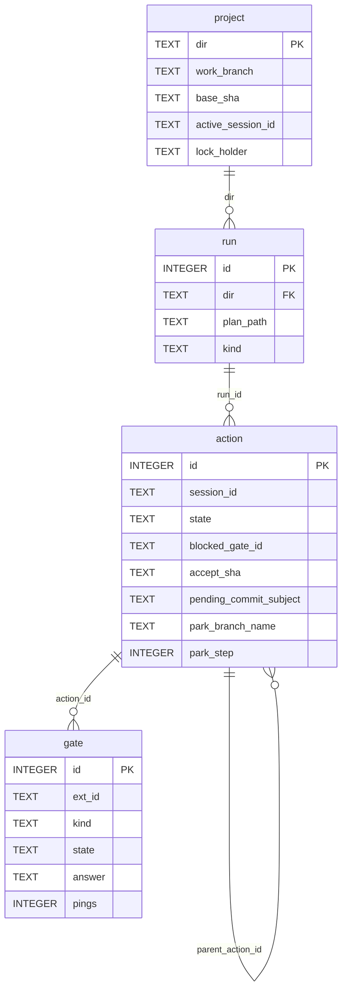

# Architecture

**Audience:** contributors who want to change ocbot and reviewers who want to judge it.
**Purpose:** show how the system is built, where state lives, and why the load-bearing decisions were made.
**Prerequisites:** [What is ocbot?](../README.md#what-is-ocbot) and the [glossary](README.md#glossary).

## System overview

ocbot runs as one process on the same host as the opencode server.
It talks to exactly four things: Discord, the opencode server, git, and SQLite.

Discord is an untrusted transport; the opencode server never leaves loopback.
Everything the bot decides is derived from fact reads: opencode status, `git log`, and the SQLite diary.

## Architectural style

The workspace follows **functional core, imperative shell** with ports and adapters.
`ocbot-core` contains every decision — the state machine, outcome classification, rendering, template engine — as pure, synchronous functions.
The shell crate (`ocbot`) contains adapters that perform I/O and wire them to the core's port traits.
The compiler enforces the split: `ocbot-core` declares no I/O dependencies, and a CI gate fails if that ever changes (NFR-11, checked by `scripts/gates.sh`).

You buy three things with this style.
The riskiest logic is exhaustively testable without mocks of the world.
Layering violations are compile errors, not review comments.
And because every conclusion is a CAS transition over a fact read, restarts and duplicates become non-events (see [Decision records](#decision-records-adrs)).

## The three crates

| Crate | Kind | Responsibility | Depends on |
|---|---|---|---|
| `ocbot-core` | library, pure + sync | State machine, outcome classification, message rendering, gate playbook, history merge, plan parsing, path safety, template engine, event vocabulary and wake policy | `serde`, `pulldown-cmark`, `regex`, `thiserror` only |
| `opencode-client` (published as `opencode-v2-client`) | library, async | Thin tolerant HTTP + SSE client for the opencode v2 API; version probe | `reqwest` (rustls), `serde`, `thiserror` |
| `ocbot` | binary | Discord adapter, store actor, git/fs adapters, wake dispatcher, loops, reconcile, metrics, bootstrap | all of the above + `serenity`, `tokio`, `rusqlite` |

### ocbot-core modules

| Module | Owns |
|---|---|
| `state` | The `State`/`Event` enums, the exhaustive transition table, CAS intent types |
| `outcome` | Pure classification of a finished session: Completed / Errored / Aborted / Empty |
| `render` | Every outgoing Discord message as a data spec (never serenity types), redaction, truncation, footer |
| `gates` | The shared permission + form playbook: what is renderable, what the buttons mean |
| `history` | Merging `git log` rows with action rows into one list |
| `plan` | Markdown plan parsing into picker options |
| `paths` | Containment checks, sanitization, slugs — the file-safety vocabulary |
| `templates` | Strict slot renderer (`{label}`, `{plan_path}`, `{git_log}`, `{git_status}`); unknown slot is a load error |
| `events` | The event vocabulary (`OcEvent`, frame classifier) and the pure `WakePolicy` |

### The shell's moving parts

| Part | Job |
|---|---|
| `adapters/discord` | Gateway event loop; defers every interaction before handler work; sends built message specs |
| `app/guard` | The chokepoint: user ID + channel scope, decided before any handler runs |
| `app/router` | The `custom_id`/slash-command grammar; splits the fast ack (plan) pass from side effects (execute) |
| `app/handlers/*` | One module per verb: `run`, `prompt`, `accept`, `park`, `reset`, `abort`, `followup`, `history`, `ls`, `status`, `gate`, … |
| `adapters/store` | The SQLite actor: one connection on a dedicated thread behind a typed message-passing handle |
| `adapters/git` | The only place `process::Command` may appear; argv-only, never a shell, never pushes |
| `app/supervisor` | Owns the single SSE connection to `/api/event` with a read deadline and backoff |
| `app/wake` | The dispatcher: frames → hints → wake policy → one targeted fact read each |
| `app/watcher`, `app/gates_loop`, `app/inbox` | The fallback ticks that bound latency if wakes stop |
| `app/ops` | The slow loop: health monitor, derived gauges, stall watchdog |
| `app/reconcile` | Boot and reconnect recovery from facts |
| `app/completion` | The idle path: classify, render, deliver the report exactly once |

## Runtime shape

Two paths feed the same decision layer.

**The interactive path.** A configured *surface* delivers an interaction (SPEC-004): Discord delivers a slash command/button/modal, Signal delivers a text command, a reaction, or a quote. The adapter normalizes it to a namespaced `ActorId` and a `Destination`; the guard decides allow/deny/ignore in one place.
The plan phase returns an ack (modal or defer) before any slow work — the ack budget is p99 < 1 s (NFR-1).
The execute phase does the port calls and store writes; every state change is a CAS transition.
The core never sees a platform shape: `AppContext.chat` is one `ChatPort`, and a fan-out implements it for multi-surface deployments. Signal has no buttons, so its adapter renders a reaction legend (recorded in `component_map`) and turns modal acks into short text conversations (`pending_input`); the router and handlers are identical on both surfaces.

**The loop path (doorbell + fallback ticks).**
The supervisor holds one SSE connection to `/api/event`.
Each frame is header-parsed into `{event, session_id}` and nothing more.
The core's pure `WakePolicy` debounces, rate-limits, and sheds hints; the dispatcher then consults the store first and issues at most one fact read per flushed wake (tracked sessions → one `activity` read; unknown sessions → one session-list read, deduped).
Wakes carry no authority: they decide *when to look*, never *what to conclude*.

If the stream dies, the supervisor reconnects with backoff, fires a coalesced reconcile, and posts exactly one "stream down" announcement after 60 s (and one recovery post).
The fallback ticks keep the system correct at their configured cadences regardless.
Setting `[events] enabled = false` disables the doorbell entirely and leaves the pure polling architecture.

## The action state machine

An **action** is the bot's record of one run.
All transitions are compare-and-swap updates (`UPDATE action SET state = :to WHERE id = :id AND state = :from`), so double-taps, Discord retries, and replays lose cleanly.
The intermediate states `accepting` and `parking` double as a write-ahead intent log: their rows carry what the next git steps will do (`pending_commit_subject`, `park_branch_name`, `park_step`), so boot reconcile can roll forward or back from database facts alone.

`errored` replaces `reported` when classification says the session failed; the decision buttons change accordingly.
`blocked` (a pending gate) is not a state — it is a substatus flag on `running`.

## Data model

Git is the source of truth for what is committed and in what order; SQLite is the differential — only what git cannot know.
Liveness of a past action is derived at render time (`accept_sha` is an ancestor of the work branch's HEAD), never stored.
The database runs in WAL mode with `foreign_keys = ON`.

Supporting tables, each with one job:

| Table | Job |
|---|---|
| `session_cursor` | Log cursor, optimization only — correctness never depends on it |
| `session_seen` | Root sessions the inbox has observed, with their directory |
| `notified` | `(session_id, seq)` dedupe keys for inbox and report delivery |
| `msg_map` | Discord message → session/action, so a reply adopts the right session |
| `mute` | Suppressed inbox reports per session or directory |
| `ui_state` | Browser cwd and hidden-file preference per user |
| `audit` | Timestamp, user, verb, action, result — never prompt bodies at INFO |
| `schema_version` | Single-row migration marker applied by the store actor at boot |

## External integrations

| Integration | Contract | Where owned |
|---|---|---|
| Discord | Gateway WS + REST via serenity 0.12; no command framework; every interaction deferred < 3 s; all posts carry `allowedMentions` restricted to the operator, enforced structurally in the core's message builder | `adapters/discord`, `ocbot-core::render` |
| opencode server | ~14 REST endpoints + the global SSE event stream; tolerant deserialization; version probed at startup, V1 refused; current pin and drift policy in [client COMPAT](../crates/opencode-client/COMPAT.md) | `opencode-client`, `adapters/opencode` |
| git | argv-only subprocess, 10 s default timeout, message by `-F tmpfile`, never pushes, never `--force` | `adapters/git` |
| Filesystem | Attachments persisted under `inbox_dir`; browser confined to `browse_roots` with containment re-verified at send time | `adapters/fs`, `ocbot-core::paths` |
| systemd | Two units (bot + opencode server) plus a nightly backup unit and timer | [DEPLOYMENT](DEPLOYMENT.md) |

## Trust model

This is remote code execution with a chat UI, and the design says so.
One allowlisted **operator** is the only trust principal; the guard rejects everyone else before any handler runs.
The bot acts only in DMs with the operator and the ops channel (plus its threads).
The opencode server must bind loopback with a password; the bot refuses to start otherwise unless you set `ALLOW_NON_LOOPBACK=true`.
Outbound messages can never ping anyone but the operator — the restriction lives in the message builder, not in handler discipline.
The shipped permission baseline marks destructive verbs (`git push`, `sudo`, `rm -rf`, `~/.ssh`) as `ask`, so a prompt-injected command hits a human.
Secrets come from the environment, are never logged, and are scrubbed from every log line by the redaction layer.
Residual risk, accepted in the spec: a stolen operator Discord account is host compromise; mitigate out of band (2FA, token rotation).

## Decision records (ADRs)

Condensed from the design specs; each records the decision and the tradeoff it accepts.

### ADR-1: Rust with a pinned toolchain

- **Context:** The bot is a state machine where a wrong transition corrupts a repository.
- **Decision:** Rust, stable channel pinned via `rust-toolchain.toml`; bumps only at phase boundaries.
- **Consequences:** Exhaustive `match` on the state machine, `Result`-everywhere, and a strict clippy floor; slower iteration than a scripting language.

### ADR-2: opencode v2 only, V1 refused

- **Context:** v1 and v2 differ in prompts admission, gates, forms, and directories.
- **Decision:** Probe `/api/info` at startup; exit non-zero naming the version if it is not v2.
- **Consequences:** Anyone on v1 cannot use the bot; the bot can rely on v2 facts (pending gate lists, durable admission, `location.directory`).

### ADR-3: Own the thin client, do not fork

- **Context:** The community SDK targets v1 with a different route and port model.
- **Decision:** Maintain a ~14-endpoint client in-repo, published as `opencode-v2-client`.
- **Consequences:** We maintain ~10% of the API surface ourselves and keep tolerant types plus a drift test that fails CI when a used endpoint disappears from the vendored spec.

### ADR-4: Pure core, imperative shell, compiler-enforced

- **Context:** The dangerous logic must be testable and isolated from I/O.
- **Decision:** `ocbot-core` declares no I/O dependencies; a CI gate fails the build if any appears.
- **Consequences:** One more port to fake per adapter; in exchange, layering is a compile error rather than a review rule.

### ADR-5: SQLite as a single-connection sync actor

- **Context:** CAS transitions want simple, poison-free transactions; there is one operator, no throughput need.
- **Decision:** `rusqlite` (bundled, WAL) on a dedicated thread behind a message-passing handle; no async SQLite, no second connection.
- **Consequences:** Serial access means `BEGIN IMMEDIATE` discipline is unnecessary; a slow query delays everything behind it — acceptable at single-operator scale.

### ADR-6: Git is the source of truth; the DB is the differential

- **Context:** Bot/database drift must never show accepted work as undone.
- **Decision:** Commit order and liveness come from `git log` and `merge-base`; the DB stores only prompts, labels, decisions, and intent.
- **Consequences:** List views cost a few git subprocess calls per render; a restored-but-older database shows recent commits as "manual" rows instead of lying.

### ADR-7: CAS transitions with a write-ahead intent log

- **Context:** Buttons double-tap; Discord retries; the process can be SIGKILLed mid-commit.
- **Decision:** Every transition is a compare-and-swap; multi-step git operations first CAS into an intermediate state whose row stores the remaining steps.
- **Consequences:** Recovery is rolling forward or back from database facts at boot; the cost is intermediate states and their reconcile table.

### ADR-8: Park commits first, then branches, then resets

- **Context:** The park sequence had crash windows that could leave the repo on the wrong branch.
- **Decision:** Commit the attempt on the work branch, create `rejected/<slug>-<n>` at that sha, then `reset --hard` to the last accepted sha; every step is idempotent and individually checkable.
- **Consequences:** The park commit briefly exists on the work branch; boot reconcile finishes the move before anything else touches the repo.

### ADR-9: Event frames are doorbells, never truth

- **Context:** The opencode event stream is volatile SSE — unordered, replay-less, occasionally lying.
- **Decision:** A frame may trigger a fact read; it must never cause a state change, Discord post, or store write. Fallback ticks survive as slow reconcilers.
- **Consequences:** Every dispatch costs one round trip and up to ~1 s of deliberate debounce latency; in exchange, duplicates, garbage, and half-open sockets are non-events by construction.

### ADR-10: Outcome classification without judgment

- **Context:** "Done" is not "success", and "the agent asked a question" is not detectable without an LLM.
- **Decision:** Classification is a pure function over snapshot fields (Completed / Errored / Aborted / Empty); the bot never inspects prose for questions — the report is the question.
- **Consequences:** An unfinished question classifies as Completed; accepted as cheaper than a heuristic wrong in both directions.

### ADR-11: No Discord command framework

- **Context:** Frameworks insert a layer between the bot and the constraint handling it must own.
- **Decision:** serenity raw, with a `custom_id` router (`v1:*` grammar) and a two-phase guard/ack design.
- **Consequences:** We own dispatch, ack discipline, and component state; no framework conveniences.

## Scaling notes

ocbot is a single-operator tool by design; multi-tenant operation is a non-goal and would be a rewrite of the trust model, not a flag.
The scaling envelope is therefore modest and deliberate: one process, one SQLite file (WAL), one SSE connection, one Discord gateway.
The practical ceilings are the memory cap (`MemoryMax=200M` in the unit file; measured ~20 MB steady, see [nfr](nfr.md)), the Discord REST queue (serenity serializes; the bot emits roughly one message per event), and git subprocess cost per render.
Beyond one operator or one host, nothing here is load-bearing — but nothing here is tuned for it either.
