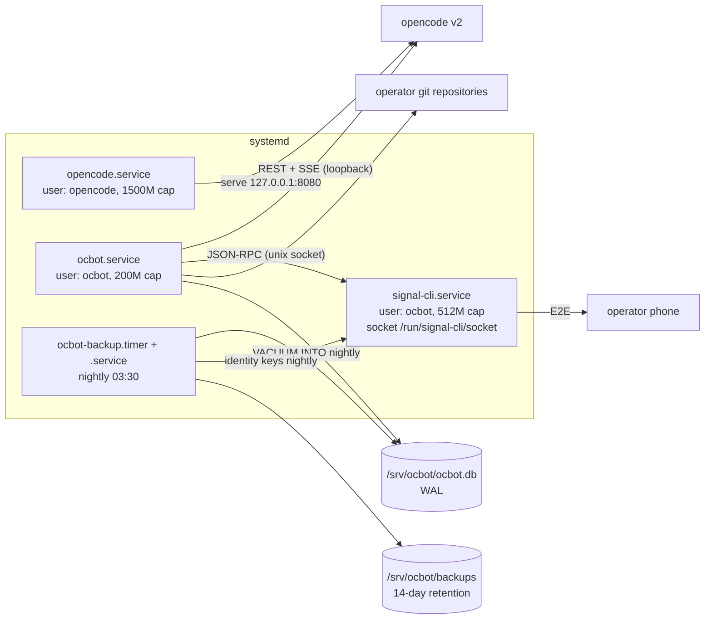

# Deployment

**Audience:** the operator installing ocbot on a host.
**Purpose:** take a built binary to a running, self-healing, backed-up production deployment.
**Prerequisites:** [Getting started](GETTING_STARTED.md) (the concepts: config, secrets, the chat surfaces); a Linux host with systemd and root.

## Environments

| | Development | Production |
|---|---|---|
| Runs as | your user | dedicated `ocbot` / `opencode` users |
| Command | `cargo run --release` from the repo root | `/usr/local/bin/ocbot` via systemd |
| Config | `config/config.toml` in the repo | `/srv/ocbot/config/config.toml` |
| Secrets | shell environment | `/etc/ocbot/ocbot.env`, mode `0600` |
| Restarts | manual | `Restart=on-failure` + SIGTERM drain |
| Backups | none expected | nightly timer, 14-day retention |
| Chat surfaces | whatever `channel` selects | the same, plus `signal-cli.service` when `signal` is selected |

## Deployment diagram



`ocbot.service` wants `opencode.service`, but the order is a soft preference: if the server is not up yet, the bot starts in degraded mode and recovers on its own.
`signal-cli.service` is optional: install it only when `channel` selects `signal`. `ocbot.service` orders itself after it when it exists, but does not require it — a dead daemon refuses the Signal surface and nothing else (D-10).

## Host layout

| Path | What |
|---|---|
| `/usr/local/bin/ocbot` | The bot binary |
| `/srv/ocbot/` | The bot's working directory (unit `WorkingDirectory`) |
| `/srv/ocbot/config/config.toml` | Configuration — the default path, resolved from the working directory |
| `/srv/ocbot/templates/` | `fresh.md` and `resume.md` |
| `/srv/ocbot/ocbot.db` | The SQLite diary (plus WAL sidecars) |
| `/srv/ocbot/inbox/` | Saved attachments |
| `/srv/ocbot/backups/` | Nightly snapshots |
| `/etc/ocbot/ocbot.env` | Secrets, mode `0600` |
| `/etc/systemd/system/ocbot.service` et al. | Units from `deploy/` |
| `/run/signal-cli/socket` | The signal-cli JSON-RPC socket, mode `0600` (`RuntimeDirectory`, `UMask=0177`) |
| `/var/lib/signal-cli/` | signal-cli's data dir: identity keys and account state (backed up nightly) |
| `/srv/opencode/`, `/etc/opencode/opencode.env` | The opencode server's working directory and secrets |

## Install

Run as root; adjust if your distro differs.

1. Create unprivileged service users:

   ```sh
   useradd -r -s /usr/sbin/nologin ocbot
   useradd -r -s /usr/sbin/nologin opencode
   ```
   `signal-cli.service` runs as **`ocbot`**, the same account as the bot: the socket's owner must be the uid that connects to it (FR-116), and the identity keys must be readable by the backup unit.
2. Build and install the binary:

   ```sh
   cargo build --release
   install -m 0755 target/release/ocbot /usr/local/bin/ocbot
   ```
3. Prepare the bot's home:

   ```sh
   mkdir -p /srv/ocbot/config /srv/ocbot/templates
   install -o ocbot -g ocbot -m 0644 config/config.toml.example /srv/ocbot/config/config.toml
   cp -r templates/. /srv/ocbot/templates/
   chown -R ocbot:ocbot /srv/ocbot
   ```
   Edit `/srv/ocbot/config/config.toml` — at minimum `opencode_url` and `allowed_user_id`, and `channel` (one surface or both; see [surface selection](GETTING_STARTED.md#step-4--configure)).
4. Write the secrets file:

   ```sh
   install -m 0600 /dev/null /etc/ocbot/ocbot.env
   $EDITOR /etc/ocbot/ocbot.env
   ```
   It needs `DISCORD_TOKEN`, `OPENCODE_PASSWORD`, and `ALLOWED_USER_ID` (see the [env var table](GETTING_STARTED.md#step-5--set-the-secrets)).
   Running the Signal surface adds `SIGNAL_OPERATOR` (your number, the only allowlisted sender) and `SIGNAL_CLI_ACCOUNT` (the daemon's own number).
   Do the equivalent for `/etc/opencode/opencode.env` with the server's password.
5. Install and start the units:

   ```sh
   cp deploy/opencode.service deploy/ocbot.service deploy/ocbot-backup.service deploy/ocbot-backup.timer /etc/systemd/system/
   systemctl daemon-reload
   systemctl enable --now opencode.service
   systemctl enable --now ocbot.service
   systemctl enable --now ocbot-backup.timer
   ```
   With `channel` selecting `signal`, also copy `deploy/signal-cli.service` and run [the signal-cli steps](#the-signal-surface) below.

The units carry hardening by default (`NoNewPrivileges`, `ProtectSystem=strict`, read-only home, private tmp) and memory ceilings: `MemoryMax=200M` for the bot, `1500M` + `CPUQuota=400%` for the server, `512M` for the signal-cli daemon.

## The Signal surface

Only these steps are needed for `signal`; skip them for a Discord-only deployment.

### 1. Install signal-cli

signal-cli is unofficial, and Signal tolerates it without supporting it — treat upgrades as a deliberate act (see [OPERATIONS](OPERATIONS.md)).
Install the [packaged release](https://github.com/AsamK/signal-cli/wiki/Quickstart) so `/usr/bin/signal-cli` exists, and note its version: the bot refuses anything older than `MIN_SIGNAL_CLI_VERSION` at boot.

### 2. Register or link a number

The daemon needs an account of its own — **the bot's number**, not yours:

```sh
sudo -u ocbot signal-cli -a +15551234567 register     # a VoIP number is usually rejected
sudo -u ocbot signal-cli -a +15551234567 verify <code>
```

A number you already use elsewhere is **linked** rather than registered:

```sh
sudo -u ocbot signal-cli -a +15551234567 link -n "ocbot host"
```

Then scan the `tsdevice:/…` URI it prints from your phone (Linked devices → Link new device).
Losing `/var/lib/signal-cli` loses this link: the nightly backup archives it, and [RESTORE](RESTORE.md#restoring-the-signal-identity) covers the re-link path.

### 3. Install the unit

```sh
install -d -o ocbot -g ocbot -m 0700 /var/lib/signal-cli
cp deploy/signal-cli.service /etc/systemd/system/
systemctl daemon-reload
systemctl enable --now signal-cli.service
```

The unit runs as `ocbot` with `UMask=0177`, so the daemon's socket lands at exactly `0600` inside `/run/signal-cli` (`RuntimeDirectory`, mode `0700`).
That is not decoration: the boot doctor refuses the Signal surface for a socket that is a regular file, world-readable, or owned by another uid (FR-116) — a readable socket would let any local user send as the bot.

### 4. Verify the safety number (once, at setup)

Signal's trust model is end-to-end: anyone who knows the bot's number can *send* to it, and only the safety number proves which device answered.
The code cannot enforce this — it is a runbook step, and the honest one:

```sh
sudo -u ocbot signal-cli -a +15551234567 listIdentities     # note the fingerprint
```

Compare it against the fingerprint shown on your phone for the bot's device (Settings → Privacy → Safety number).
Record it somewhere you trust; re-check it after any re-link.

### 5. Point the bot at it

In `[signal]`:

```toml
[signal]
socket = "/run/signal-cli/socket"
operator_number = "+15559876543"     # your number — the only sender served
```

and in `channel`: `"signal"` or `["discord", "signal"]`.
`systemctl restart ocbot`, then look for `signal-cli daemon healthy (FR-114/FR-116)` in the log.

A wrong-version or unhygienic daemon refuses **the Signal surface only**: with Discord selected the process keeps booting, and with nothing left it exits `3`.

## Secrets management

Secrets live only in the two `0600` env files, read by systemd before the privilege drop.
They never go in `config.toml`, the database, or logs — the log writer scrubs secret-shaped strings, and a structural gate (G17) keeps secret values out of the repository.
Rotate by editing the env file and restarting: `systemctl restart ocbot`.

## Upgrades and rollback

There is no continuous delivery — deployment is manual, and CI only gates what lands on `main`.

Upgrade the bot:

```sh
git pull
cargo build --release
install -m 0755 target/release/ocbot /usr/local/bin/ocbot
systemctl restart ocbot
```

The startup doctor validates config, templates, server version, and the permission baseline on every boot; a bad upgrade fails loudly at restart, not silently.
The store applies any schema migrations at boot (a single `schema_version` row).

Rollback: keep the previous binary (for example as `/usr/local/bin/ocbot.prev`), then stop, swap, and start.
Before downgrading, check [CHANGELOG](../CHANGELOG.md) for schema migrations — if a release migrated the database, rehearse the downgrade on a copy of `ocbot.db` first.
[TODO: a release-by-release note if/when a migration ships]

Upgrading the opencode server is a deliberate act: bump the pin in [client COMPAT](../crates/opencode-client/COMPAT.md), re-record fixtures, and let the nightly contract job confirm.

Upgrade signal-cli:

```sh
systemctl stop signal-cli.service
<install the new version>          # distro package or release tarball
systemctl start signal-cli.service
journalctl -u ocbot -o cat -n 5    # "signal-cli daemon healthy" or the reason it refused
```

The JSON-RPC schema is advisory, not contractual, and the bot pins a protocol subset (recorded in `crates/ocbot/src/adapters/signal/KNOWN_CAPS.md`).
A version below `MIN_SIGNAL_CLI_VERSION` refuses the Signal surface with a log line naming both versions — Discord keeps serving, and you can downgrade signal-cli or drop `signal` from `channel`.
`cargo test -p ocbot --test signal_contract` is the executable form of that contract: run it after any daemon upgrade that changes the wire shapes.

## Backups

The `ocbot-backup.timer` fires nightly at 03:30 (±5 minutes) and runs `scripts/backup.sh`: a `VACUUM INTO` snapshot of the live WAL database **and** a compressed copy of the signal-cli data dir (identity keys), each pruned to 14 days by mtime.
The signal archive is skipped when the data dir is absent — a Discord-only deployment is not a failure.
A failed backup exits non-zero, which systemd records — check `systemctl --failed` after failures.
Restore procedures and the recorded drill live in [RESTORE](RESTORE.md) (the runbook owner).

## Post-deploy smoke tests

1. `systemctl status ocbot.service` — active, no restart loop.
2. `journalctl -u ocbot -o cat -n 20` — JSON log lines ending in `connected to discord`, and `signal-cli daemon healthy (FR-114/FR-116)` when the Signal surface runs.
3. `/status` in Discord — server reachable, version shown, no held locks.
4. `curl -s http://127.0.0.1:9464/metrics | grep ocbot_opencode_up` — `1`.
5. `/run` a prompt in a scratch repository and take one decision on the report.
6. On the Signal surface: send `status` from your phone; you should get the same answer as `/status`, and both `ocbot_surface_up` gauges should read `1`.
7. Occasionally: `scripts/restore-drill.sh` — the full backup→restore path (diary and identity keys) against canary files.
