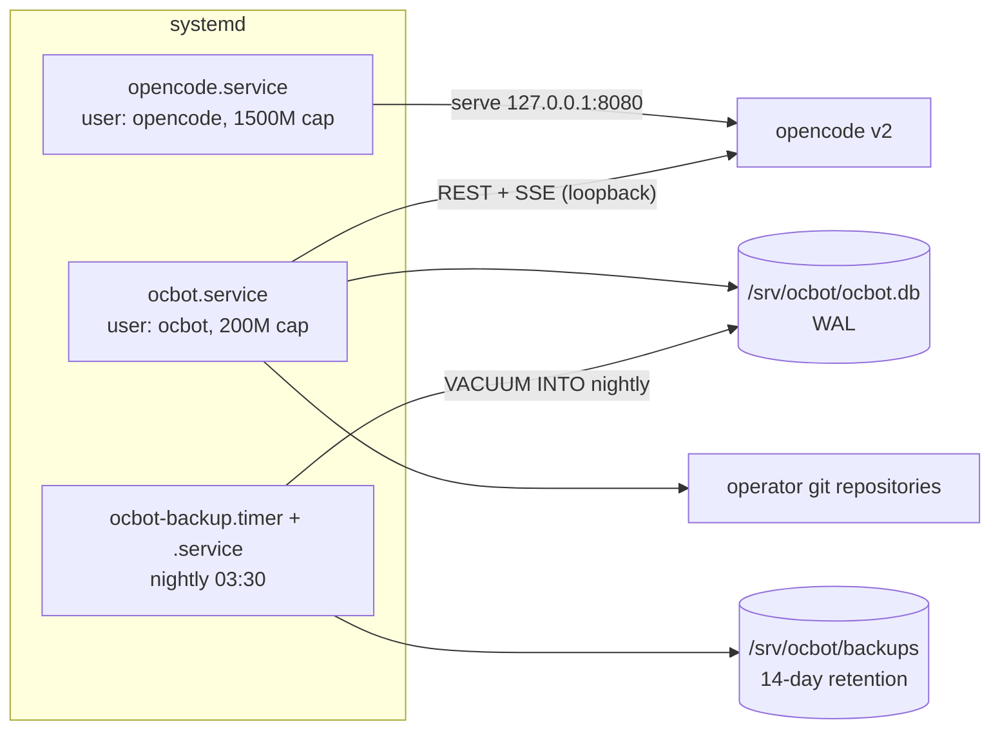

# Deployment

**Audience:** the operator installing ocbot on a host.
**Purpose:** take a built binary to a running, self-healing, backed-up production deployment.
**Prerequisites:** [Getting started](GETTING_STARTED.md) (the concepts: config, secrets, the Discord bot); a Linux host with systemd and root.

## Environments

| | Development | Production |
|---|---|---|
| Runs as | your user | dedicated `ocbot` / `opencode` users |
| Command | `cargo run --release` from the repo root | `/usr/local/bin/ocbot` via systemd |
| Config | `config/config.toml` in the repo | `/srv/ocbot/config/config.toml` |
| Secrets | shell environment | `/etc/ocbot/ocbot.env`, mode `0600` |
| Restarts | manual | `Restart=on-failure` + SIGTERM drain |
| Backups | none expected | nightly timer, 14-day retention |

## Deployment diagram



`ocbot.service` wants `opencode.service`, but the order is a soft preference: if the server is not up yet, the bot starts in degraded mode and recovers on its own.

## Host layout

| Path | What |
|---|---|
| `/usr/local/bin/ocbot` | The bot binary |
| `/srv/ocbot/` | The bot's working directory (unit `WorkingDirectory`) |
| `/srv/ocbot/config/config.toml` | Configuration — the default path, resolved from the working directory |
| `/srv/ocbot/templates/` | `fresh.md` and `resume.md` |
| `/srv/ocbot/ocbot.db` | The SQLite diary (plus WAL sidecars) |
| `/srv/ocbot/inbox/` | Saved attachments |
| `/srv/ocbot/backups/` | Nightly snapshots |
| `/etc/ocbot/ocbot.env` | Secrets, mode `0600` |
| `/etc/systemd/system/ocbot.service` et al. | Units from `deploy/` |
| `/srv/opencode/`, `/etc/opencode/opencode.env` | The opencode server's working directory and secrets |

## Install

Run as root; adjust if your distro differs.

1. Create unprivileged service users:

   ```sh
   useradd -r -s /usr/sbin/nologin ocbot
   useradd -r -s /usr/sbin/nologin opencode
   ```
2. Build and install the binary:

   ```sh
   cargo build --release
   install -m 0755 target/release/ocbot /usr/local/bin/ocbot
   ```
3. Prepare the bot's home:

   ```sh
   mkdir -p /srv/ocbot/config /srv/ocbot/templates
   install -o ocbot -g ocbot -m 0644 config/config.toml.example /srv/ocbot/config/config.toml
   cp -r templates/. /srv/ocbot/templates/
   chown -R ocbot:ocbot /srv/ocbot
   ```
   Edit `/srv/ocbot/config/config.toml` — at minimum `opencode_url` and `allowed_user_id`.
4. Write the secrets file:

   ```sh
   install -m 0600 /dev/null /etc/ocbot/ocbot.env
   $EDITOR /etc/ocbot/ocbot.env
   ```
   It needs `DISCORD_TOKEN`, `OPENCODE_PASSWORD`, and `ALLOWED_USER_ID` (see the [env var table](GETTING_STARTED.md#step-5--set-the-secrets)).
   Do the equivalent for `/etc/opencode/opencode.env` with the server's password.
5. Install and start the units:

   ```sh
   cp deploy/opencode.service deploy/ocbot.service deploy/ocbot-backup.service deploy/ocbot-backup.timer /etc/systemd/system/
   systemctl daemon-reload
   systemctl enable --now opencode.service
   systemctl enable --now ocbot.service
   systemctl enable --now ocbot-backup.timer
   ```

The units carry hardening by default (`NoNewPrivileges`, `ProtectSystem=strict`, read-only home, private tmp) and memory ceilings: `MemoryMax=200M` for the bot, `1500M` + `CPUQuota=400%` for the server.

## Secrets management

Secrets live only in the two `0600` env files, read by systemd before the privilege drop.
They never go in `config.toml`, the database, or logs — the log writer scrubs secret-shaped strings, and a structural gate (G17) keeps secret values out of the repository.
Rotate by editing the env file and restarting: `systemctl restart ocbot`.

## Upgrades and rollback

There is no continuous delivery — deployment is manual, and CI only gates what lands on `main`.

Upgrade the bot:

```sh
git pull
cargo build --release
install -m 0755 target/release/ocbot /usr/local/bin/ocbot
systemctl restart ocbot
```

The startup doctor validates config, templates, server version, and the permission baseline on every boot; a bad upgrade fails loudly at restart, not silently.
The store applies any schema migrations at boot (a single `schema_version` row).

Rollback: keep the previous binary (for example as `/usr/local/bin/ocbot.prev`), then stop, swap, and start.
Before downgrading, check [CHANGELOG](../CHANGELOG.md) for schema migrations — if a release migrated the database, rehearse the downgrade on a copy of `ocbot.db` first.
[TODO: a release-by-release note if/when a migration ships]

Upgrading the opencode server is a deliberate act: bump the pin in [client COMPAT](../crates/opencode-client/COMPAT.md), re-record fixtures, and let the nightly contract job confirm.

## Backups

The `ocbot-backup.timer` fires nightly at 03:30 (±5 minutes) and runs `scripts/backup.sh`: a `VACUUM INTO` snapshot of the live WAL database, pruned to 14 days by mtime.
A failed backup exits non-zero, which systemd records — check `systemctl --failed` after failures.
Restore procedures and the recorded drill live in [RESTORE](RESTORE.md) (the runbook owner).

## Post-deploy smoke tests

1. `systemctl status ocbot.service` — active, no restart loop.
2. `journalctl -u ocbot -o cat -n 20` — JSON log lines ending in `connected to discord`.
3. `/status` in Discord — server reachable, version shown, no held locks.
4. `curl -s http://127.0.0.1:9464/metrics | grep ocbot_opencode_up` — `1`.
5. `/run` a prompt in a scratch repository and take one decision on the report.
6. Occasionally: `scripts/restore-drill.sh` — the full backup→restore path against a canary database.
