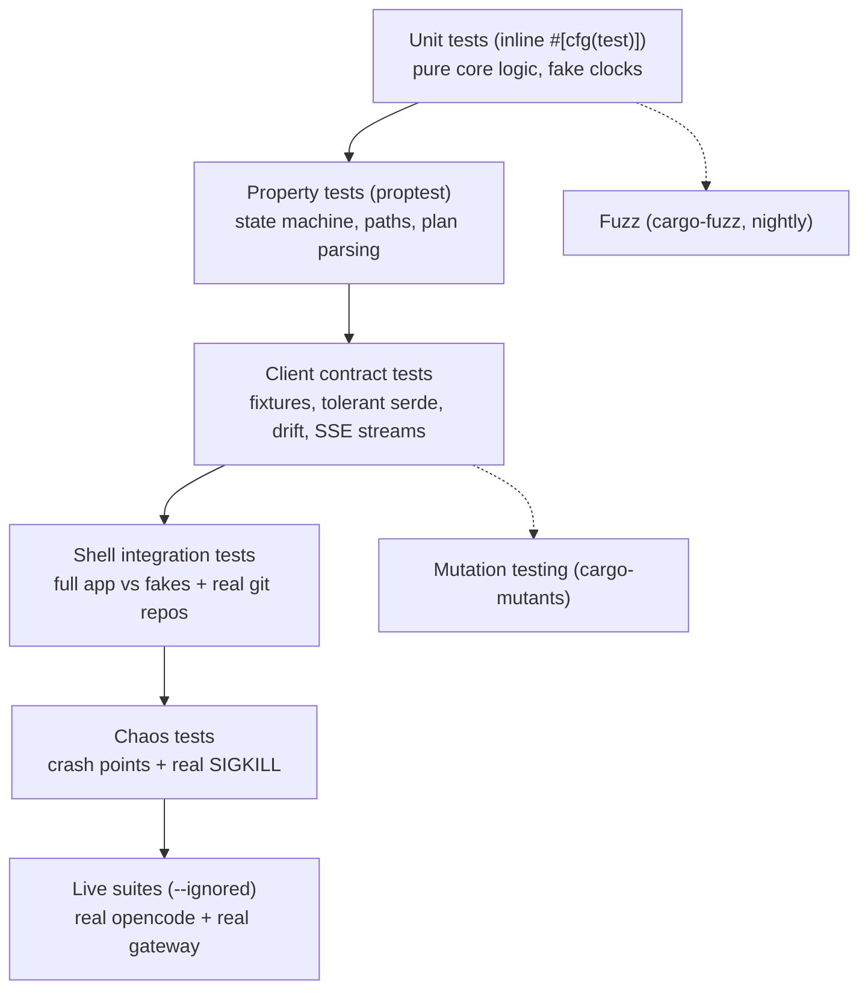

# Testing

**Audience:** contributors writing or running tests.
**Purpose:** know which suite proves what, how to run it, and what a change must add.
**Prerequisites:** a building workspace ([CONTRIBUTING](CONTRIBUTING.md#dev-setup)); test crates are named there.

## The testing estate

ocbot's tests are layered by how much of the world is real.
Lower layers are fast and run on every PR; the top layers need a live server or a nightly runner.



| Layer | Proves | Runs where |
|---|---|---|
| Unit + property | Core decisions are correct and total | Every PR |
| Client contract | The client speaks the pinned server API, tolerantly | Every PR |
| Shell integration | Handlers, store, router, loops work end-to-end with fakes | Every PR |
| Chaos | SIGKILL at any crash point loses no accepted work | Every PR (snapshot) / nightly (real SIGKILL) |
| Live | The real server and gateway contracts | Nightly, or manually with `--ignored` |
| Fuzz | Hostile JSON never panics the client | Nightly |
| Mutation | Tests would catch behavioral mutants | Scoped per PR, full core nightly |

## Running the suites

| Suite | Command |
|---|---|
| Everything offline | `cargo nextest run --workspace` |
| Doc tests | `cargo test --doc --workspace` |
| One integration suite | `cargo nextest run -p ocbot --test double_tap` |
| Core only | `cargo nextest run -p ocbot-core` |
| Coverage gates | `./scripts/coverage.sh` |
| Structural gates | `./scripts/gates.sh` |
| Live suites | see [Live tests](#live-tests) |
| Fuzz | see [Fuzzing](#fuzzing) |
| Mutation | see [Mutation testing](#mutation-testing) |

Most offline suites finish in well under a second — the e2e report-latency suite cycles the real client and adapter 100 times in about a quarter second.

## Layout and naming

- Unit tests live inline in `#[cfg(test)] mod tests` inside each module.
- Integration tests live in `crates/<crate>/tests/`, one file per behavior, named after it: `double_tap.rs` (exactly-once decisions), `chaos_sigkill.rs`, `drift.rs`, `e2e_report_latency.rs`.
- `crates/ocbot/tests/common/mod.rs` is the shared harness: `FakeOpenCode`, `FakeChat`, `FakeGit`, plus helpers that create real temporary git repositories (`init_repo`, `write_file`) and wire a full app `context`. `common/signal_fake.rs` is the pinned signal-cli daemon; `common/signal_surface.rs` builds the live Signal surface the two Signal suites drive.
- Client tests feed canned SSE fixtures through wiremock (`tests/streams.rs`) and the vendored OpenAPI spec (`tests/drift.rs`).
- Integration tests assert by unwrapping; the crate-level `#![allow(...)]` with a reason covers the lint floor's test exemption.
- `signal_flows.rs` holds the modal-parity proof: `assert_modal_parity` compares the Signal text form's synthesized `ModalSubmit` against the Discord harness's, and a meta-test fails when the router accepts a modal that no Signal flow covers.

## Coverage

Gates are per crate, measured on each crate's own tests — a crate's floor is not met by coverage donated from another crate's suite.

| Crate | Floor | Last measured (2026-10-08) |
|---|---|---|
| `ocbot-core` | ≥ 90% lines | 94.7% |
| `opencode-v2-client` | ≥ 90% lines | 93.7% |
| `ocbot` (shell) | ≥ 70% lines | 77.8% |

Check locally:

```sh
./scripts/coverage.sh
```

Or one crate: `cargo llvm-cov -p ocbot-core --fail-under-lines 90 --summary-only`.
The shell floor is lower by design: bootstrap (`run.rs`, `main.rs`), the serenity gateway loop, and the child-process crash harness cannot run without a live environment — those are the residual misses, and the live suites cover them the only way they can be covered.
Measured history and per-NFR budgets: [nfr](nfr.md).

## Live tests

Two suites need a real opencode v2 server:

```sh
export OPENCODE_URL="http://127.0.0.1:8080"
export OPENCODE_PASSWORD="<opencode password>"
cargo test -p ocbot --test live_manual -- --ignored   # the spine: real server end-to-end

# live_boot drives the real binary, so it also needs the Discord surface:
export DISCORD_TOKEN="<bot token>"
export ALLOWED_USER_ID="<your Discord user id>"
cargo test -p ocbot --test live_boot -- --ignored      # boot + SIGTERM drain
```

A suggested manual pass with a scratch repository: force a permission prompt and answer it from Discord; Accept, Park & redo, and Reset; run a session in a terminal and adopt it from the inbox; `/ls` a plan and `/status`; scrape the metrics endpoint and check the logs carry no secrets.
The nightly `contract` CI job runs the client spike against a real server with repository secrets.

## Fuzzing

The `fuzz/` directory is a separate cargo-fuzz workspace on the nightly toolchain — excluded from `cargo test --workspace` on purpose.

```sh
cd fuzz
cargo fuzz run serde_fuzz --sanitizer address -- -max_total_time=120
cargo fuzz run surface_fuzz --sanitizer address -- -max_total_time=120
```

`serde_fuzz` hammers the client's deserialization: unknown fields, missing fields, hostile JSON — every input must produce a `Result`, never a panic.
`surface_fuzz` (SPEC-004 PH-8) aims the same discipline at the three parsers that sit on the chat-surface boundary: the pure text grammar (`ocbot-core::grammar`), the signal-cli envelope decoder, and the config deserializer.

## Mutation testing

`cargo-mutants` checks that tests would catch real behavior changes.
Per PR, CI mutates the core decision modules (state, render, history, plan, paths); nightly mutates all of `ocbot-core`.

```sh
cargo mutants --file crates/ocbot-core/src/state.rs --test-package ocbot-core
```

Recent recorded results (2026-10-08, see [nfr](nfr.md)): `plan.rs` 52 mutants, 0 missed; `paths.rs` 95/100; `stall.rs` 10/10.

## Chaos testing

Accept, Park & redo, and Reset are crash-tested, not just unit-tested.
`chaos_full` drives the flows through 11 labelled crash points against snapshots; `chaos_sigkill` sends real `SIGKILL`s at the labelled points and proves boot reconcile recovers; `store_actor_chaos` kills between typed store commits and proves WAL recovery.
The guarantee under test: SIGKILL anywhere ⇒ consistent state within 10 seconds of reboot, zero lost accepted work (NFR-5).
If you add a crash window (an intermediate state, a multi-step git sequence), add a labelled crash point to the suite.

The chat surfaces are chaos-tested too (SPEC-004 PH-8, `chaos_signal`): the signal-cli daemon dies under a live subscription (the machine reconnects, and a buffered envelope is never delivered twice), dies mid-send (a point post propagates its error while a broadcast still delivers on the surviving surface), and dies repeatedly (the reconnect backoff respects its ceiling). `load_fanout` then bounds the happy path: the design envelope's ten-minute volume goes through the real fan-out with per-send latency, send counters, and the queue-depth gauge all asserted.

## What is deliberately not tested offline

Three surfaces stay live-only, on purpose:

1. The serenity gateway loop — interaction ingestion, ack discipline, reconnect. Only the pure payload builder is unit-tested.
2. The real opencode contract — covered by the live suites and the nightly contract job, never by fixtures that could go stale silently.
3. Discord realities — rate limits, rendered message behavior on real clients.

If your change touches these, say so in the PR and expect a manual pass against a real server.

## Writing a new test

- New behavior in a handler, loop, or the store: an integration test in `crates/ocbot/tests/`, named after the behavior, using the `common` harness.
- A new `State`, `Event`, or classification branch: core unit tests plus a `proptest` case where the transition table's exhaustiveness matters.
- A new client endpoint: a fixture, a tolerant-serde case, and a `drift.rs` entry — the endpoint must exist in the vendored spec.
- A new crash window: a labelled crash point in the chaos suite.
- Keep suites fast; if yours needs a sleep, question the design before the test does.
